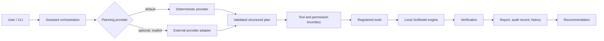
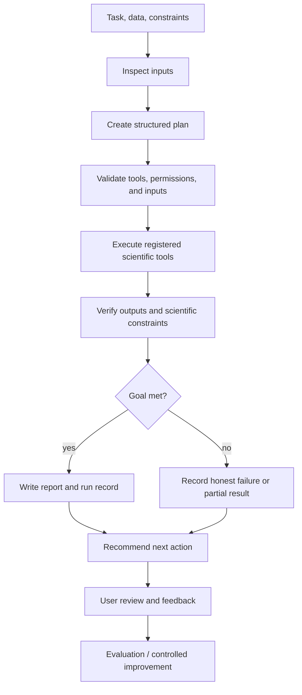

# SciModel Architecture

## Architectural intent

SciModel uses a layered, dependency-inverted architecture. Scientific rules and use-case decisions must remain testable without a CLI, filesystem, database, MATLAB installation, or network service.

The repository now contains the first complete vertical slice. The
deterministic planner is the default, while provider-based planning is an
optional boundary. Scientific computation remains local and independent of
any language-model provider.



```text
interfaces  →  application  →  domain
     ↓              ↓             ↑
infrastructure  → ports ← adapters
```

The arrows describe allowed dependency direction. The domain must not import application, interfaces, infrastructure, or concrete scientific libraries.

## Package boundaries

| Package | Responsibility | Must not own |
|---|---|---|
| `domain` | Scientific concepts, invariants, value objects, and domain-level errors | CLI parsing, file I/O, pandas, SciPy, network calls |
| `application` | Use cases, orchestration, ports, and transaction-level policies | Terminal formatting or vendor-specific details |
| `adapters` | Conversion between external representations and application/domain contracts | Core scientific decisions |
| `infrastructure` | Filesystem, configuration, logging, persistence, and third-party integrations | User-facing workflow policy |
| `interfaces` | CLI commands, serialization, and presentation | Model-fitting algorithms or domain invariants |

## SOLID rules for implementation

- **Single responsibility:** one component should have one reason to change.
- **Open/closed:** add a model or input format through an interface and adapter rather than editing unrelated use cases.
- **Liskov substitution:** every solver implementation must honor the same input, output, error, and metadata contract.
- **Interface segregation:** keep ports small and specific; do not create one universal service interface.
- **Dependency inversion:** application code depends on protocols/ports; infrastructure provides implementations.

## Scientific workflow boundary

The first vertical slice should follow this sequence:

1. Load data through an input port.
2. Build an explicit data profile without silently changing source data.
3. Validate the research objective and model configuration.
4. Execute one selected solver through a model port.
5. Run diagnostics and uncertainty calculations appropriate to that model.
6. Persist a run manifest and render a human-readable report.

Each step should expose structured results and warnings. Terminal text is a presentation concern, not a scientific result format.

## Current provider and deployment boundary

SciModel is local-first:

- The deterministic provider and scientific engine run locally.
- No network call is required for the supported workflow.
- Provider plans must identify themselves and contain validated steps.
- A provider may plan work, but it cannot bypass registered tools or execute
  arbitrary code through the assistant boundary.
- Scientific fitting, validation, reports, and audit records remain local.
- A hosted provider is not enabled by default and must be introduced through
  the gated process in [`PROVIDER_INTEGRATION_WORKFLOW.md`](PROVIDER_INTEGRATION_WORKFLOW.md).

The current implementation has a JSON plan adapter for controlled integration
testing. It is not evidence that a hosted or local language model has been
installed or approved for production use.

## End-to-end procedure



## Deferred decisions

The following remain intentionally deferred:

- Additional scientific domains and model families beyond the supported
  kinetics workflow.
- A dataframe/array abstraction beyond the selected workflow.
- Configuration file format for user projects.
- MATLAB integration.
- A database or hosted service.
- Plugin discovery and third-party solver loading.

Record each decision in `docs/decisions/` when the Phase 0 scope brief provides enough evidence.
