# Local-First Provider Setup

## Purpose

This document defines how the assistant should be configured before adding a
local or hosted language model. The goal is to preserve the verified local
workflow while making future provider integration replaceable, testable, and
controlled.

## Current setup

| Capability | Current state |
|---|---|
| Scientific engine | Local SciModel code using the verified tools |
| Default planner | Deterministic provider |
| Provider interface | Implemented and tested |
| External plan input | Validated JSON plan adapter implemented |
| Hosted model | Not connected or enabled |
| Local language model | Not downloaded or enabled |
| Network requirement | None for the supported workflow |
| Scientific execution | Local only |

The repository is ready for provider evaluation, but not yet for provider
activation. The deterministic planner remains authoritative.

## Recommended operating modes

### Local baseline — current default

Use the deterministic provider and the local scientific engine. This mode is
the reference behavior for regression tests, audit records, and scientific
results.

```bash
python -m scimodel assistant run \
  examples/enzyme_kinetics_puromycin.csv \
  --goal "Analyze this enzyme-kinetics dataset and recommend the next action" \
  --mode audit \
  --output-dir reports/assistant-run
```

### Provider-plan evaluation — available now

Use a pre-generated JSON plan to test the provider contract without giving a
provider direct access to tools or scientific computation.

```bash
python -m scimodel assistant run \
  examples/enzyme_kinetics_puromycin.csv \
  --goal "Evaluate a controlled provider plan" \
  --provider-plan path/to/plan.json \
  --mode audit \
  --output-dir reports/provider-plan
```

### Local or hosted language model — future evaluation modes

When a model is selected, it should be added behind `AssistantProvider`. It
may propose a structured plan, but the existing validation, tool registry,
scientific engine, verification, reporting, and audit boundaries must remain
unchanged. A hosted provider must be explicit opt-in.

## Configuration contract for the next implementation step

| Setting | Safe initial value | Meaning |
|---|---|---|
| `execution_mode` | `local` | Selects the local-first execution policy |
| `provider` | `deterministic` | Selects the planning implementation |
| `model` | empty | No language model is active yet |
| `allow_network` | `false` | Prevents accidental external calls |
| `require_approval_for_cloud` | `true` | Requires explicit user approval |
| `timeout_seconds` | bounded value | Prevents hanging provider calls |
| `max_context_size` | bounded value | Controls data sent to a provider |
| `model_revision` | recorded value | Makes provider runs reproducible |

This is a configuration contract, not a claim that all of these settings are
already consumed by the CLI.

## Provider activation gates

```mermaid
flowchart LR
    G0[0. Freeze local baseline] --> G1[1. Select provider and license]
    G1 --> G2[2. Implement provider adapter]
    G2 --> G3[3. Validate plan schema and permissions]
    G3 --> G4[4. Run private benchmark]
    G4 --> G5[5. Shadow compare with deterministic baseline]
    G5 --> G6[6. Limited activation with approval]
    G6 --> G7[7. Controlled improvement and regression tests]
```



Current position: **Gates 0–2 foundation complete**. Gates 3–7 still require
provider-specific implementation and evidence.

## Rules

- Do not put secrets, tokens, or private datasets in run records.
- Redact provider-bound context before any future network call.
- Keep the scientific engine independent of the provider.
- Treat provider output as a proposal, never as verified scientific truth.
- Require verification before reporting success.
- Record provider name, version, model revision, and failure details.
- Do not allow provider-generated arbitrary shell commands.

## Next action

Before downloading or connecting a model, record the target hardware and the
first provider choice. Then implement only the adapter and benchmark needed
for that choice. Do not activate it globally until it matches the
deterministic baseline on the evaluation suite.
