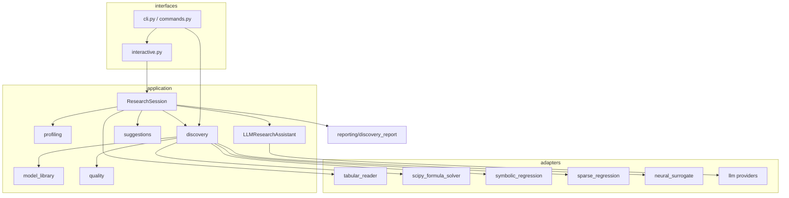
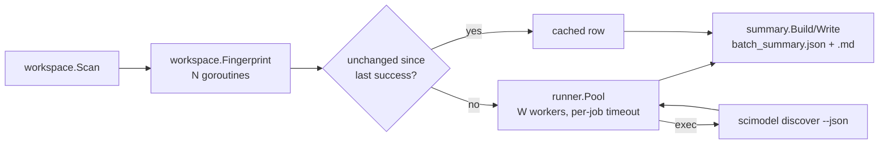

# Architecture

SciModel is a layered, dependency-inverted Python package with two companions: a Go
binary for concurrent batch work and Bash scripts for the developer and release
workflow. Each language does what it is best at:

| Language | Responsibility | Why |
|---|---|---|
| **Python** (`src/scimodel/`) | All scientific computation, the CLI, the interactive assistant, reports | NumPy/SciPy ecosystem; the single source of scientific truth |
| **Go** (`batch/`) | Scanning many folders, parallel fingerprinting, a bounded worker pool of discovery jobs, timeouts, cancellation, cross-dataset summaries | Goroutines, contexts and static binaries make robust concurrency simple |
| **Bash** (`scripts/`) | Setup, quality gate, coverage, builds, smoke tests, releases; the same scripts run locally and in CI | Ubiquitous glue with no extra dependencies |

The Go runner never computes science. It invokes `scimodel discover --json` and only
aggregates its output, so results are identical whether a dataset is analyzed alone or in a
batch of a thousand.

## Repository layout

```text
scimodel/
├── src/scimodel/          Python package
│   ├── domain/            Pure concepts: Dataset, ModelFormula (AST-safe), FitResult,
│   │                      discovery & quality contracts, ports (solver, recommender, LLM)
│   ├── application/       Use cases: profiling, model library, discovery, quality,
│   │                      suggestions, LLM assistant, research session, workspace scan,
│   │                      plus the original kinetics workflow and assistant audit trail
│   ├── adapters/          Technology bindings: table reader, SciPy solver & statistics,
│   │                      symbolic/sparse regression, neural surrogate, plotting,
│   │                      MATLAB solver, llm/ (Anthropic, Ollama)
│   ├── infrastructure/    Configuration, reproducibility manifests, run/context stores
│   ├── reporting/         Discovery report bundle and the kinetics report
│   ├── evaluation/        Assistant benchmark suite
│   └── interfaces/        cli.py (entry point), commands.py, interactive.py
├── batch/                 Go module: cmd/scimodel-batch, internal/{workspace,runner,summary}
├── scripts/               Bash workflow: setup, check, coverage, build, smoke, batch, release
├── tests/                 unit/, integration/, scientific/ (known-answer benchmarks)
├── examples/              Real and synthetic datasets + generator with ground truth
├── docs/                  Guides and decision records
└── .github/               CI, release, dependabot, issue/PR templates
```

## Python layers

```text
interfaces  →  application  →  domain
     ↓              ↓             ↑
infrastructure  →  ports  ←  adapters
```

The arrows show allowed import direction. `domain` imports only NumPy and the standard
library: no SciPy, file I/O, CLI, or network. Concrete technology lives in `adapters` and
is reached through the protocols in `domain/ports.py`:

| Port | Implementations |
|---|---|
| `ModelSolverPort` | `ScipyFormulaSolver` (default), `MatlabFormulaSolver` (optional) |
| `FormulaRecommenderPort` | `RuleBasedFormulaRecommender`, `LLMFormulaRecommender` |
| `LanguageModelPort` | `AnthropicProvider`, `OllamaProvider` |
| `AssistantProvider` | `DeterministicProvider`, `JsonPlanProvider` |

### Main components



- `ResearchSession` is the UI-independent state behind the assistant (workspace, open
  dataset, latest result, history). `interactive.py` is a thin conversation loop over a
  `Terminal` protocol, so it is fully testable with scripted input.
- `discover()` is a pure function of (dataset, target, predictors, options) and returns a
  serializable `DiscoveryResult`. CLI, session, and batch runs all call it.
- Engines return `CandidateProposal`s. Fitting, scoring and ranking are shared, so a new
  engine only has to propose formulas.

## Go batch runner



- **Bounded parallelism:** `-workers` goroutines consume a job channel. Results keep input
  order.
- **Timeouts and cancellation:** each job runs under `context.WithTimeout`. Ctrl-C/SIGTERM
  cancels in-flight jobs and marks the rest `cancelled`. A summary is always written.
- **Incremental:** SHA-256 fingerprints let reruns skip datasets that are unchanged since
  their last successful analysis.
- **Exit codes:** 0 all ok, 2 bad flags, 3 at least one job failed, timed out, or was
  cancelled.
- `runner.Executor` is an interface, so the pool is unit-tested (with `-race`) without Python.

## Extension points

| To add… | Implement | Register in |
|---|---|---|
| A scientific model family | a builder in `univariate_templates`/`multivariate_templates` | `application/model_library.py` |
| A discovery engine | a function returning `CandidateProposal`s | `run_engine(...)` in `application/discovery.py` |
| A quality check | a function returning `QualityCheck` | `assess_candidate` + `_WEIGHTS` in `application/quality.py` |
| An input format | a `_read_<format>` function | `read_table` in `adapters/tabular_reader.py` |
| A language-model provider | the `LanguageModelPort` protocol | `create_language_model` in `adapters/llm/__init__.py` |
| A numerical backend | the `ModelSolverPort` protocol | adapters + CLI `--backend` |

## Safety boundaries

- Formulas from any source (user, file, LLM) are parsed with `ast` and checked against a
  whitelist of operators, functions (`exp`, `log`, `sqrt`, trigonometric, hyperbolic, …),
  the constant `pi`, declared parameters, and declared variables.
- Language models receive summary statistics by default. Raw rows are sent only with an
  explicit opt-in. API keys are never stored by SciModel.
- Run records redact secret-like fields before persistence.
