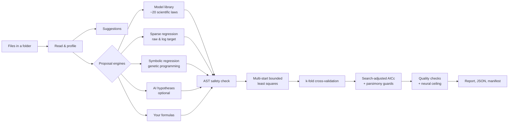

# How SciModel works

This page describes the method behind every result: how data are read, how candidate
equations are generated, how they are fitted, ranked and graded, how language models are
kept honest, and how all of this is validated.

## 1. Reading and profiling

**Reading** (`adapters/tabular_reader.py`). Delimiters are sniffed. Comment lines are
skipped, and units are split from headers (`temperature [K]` becomes column `temperature`,
unit `K`). Names are turned into safe identifiers. A column is numeric only if every
non-missing value parses as a number. Missing values become NaN and are never imputed.

**Profiling** (`application/profiling.py`) produces:

- **Column roles:** `index` (IDs, replicate counters, 1-step integer sequences), `time`,
  `temperature`, `constant`, `grouping`/`label` (text), or `measurement`. Roles are decided
  by whole-token name hints and value patterns.
- **Response and predictors:** the response is the first measured column whose name
  contains a response token (`rate`, `velocity`, `od600`, `yield`, `period`, …), otherwise
  the last measured column. Predictors are the remaining usable numeric columns.
- **Relationship shape** for each predictor, computed on replicate means:
  monotonicity (Spearman ρ); straight-line fits after linearizing transforms (log–log →
  power law, semi-log → exponential, log-x, 1/x); saturation and acceleration
  (start vs end slope); sigmoid shape; interior peak or valley on a smoothed curve with few
  turning points; oscillation (zero crossings of the detrended curve, with dominant
  amplitude and lag-1 autocorrelation > 0.5, which rejects noise).
- **Quality issues:** missing values, robust outliers (> 4 MAD-scaled SDs), constant
  columns, small samples, replicated settings.

The shape hints only steer suggestions and seed some engines. They never decide the final
model.

## 2. Proposal engines

| Engine | What it proposes | Search space M |
|---|---|---|
| **library** | Established families whose mathematical domain the data satisfy: linear, quadratic, power law (± offset), exponential, first-order approach to plateau, logarithmic, reciprocal, Michaelis–Menten/Langmuir/Monod hyperbola, Hill, logistic, Gompertz, Gaussian peak, sinusoid, damped oscillator, Arrhenius (centred at mean T); with several predictors, additive linear, multiplicative power law, and pairwise interactions. Each has data-driven starting values (linearizations, plateaus, half-maximum points, FFT frequency) and often several starts. | number of templates proposed |
| **sparse** | Best-subset regression over interpretable features (x, x², x³, √x, log x, 1/x, e^(−x/s), x₁x₂, x₁/x₂). Exhaustive for small subsets, BIC stops adding terms. Runs on y and, for positive y, on log y, which turns multiplicative laws (power laws, Arrhenius × reaction order) into linear sums. | 2·C(features, terms) |
| **symbolic** | Genetic programming over expression trees (+ − × ÷, square, √, exp, log, 1/x; sin/cos when oscillation is detected), with linear scaling, tournament selection, subtree crossover and mutation, and a parsimony pressure. A Pareto front of accuracy vs complexity is kept, and every numeric constant becomes a fitted parameter. Seeded and time-budgeted. | distinct expressions evaluated |
| **llm** | Hypotheses from Claude or a local Ollama model (see §6). | number proposed |
| **user** | Formulas you pass with `--formula` or `/fit`. Free symbols become parameters. | 1 |

Engines are isolated: a failing engine is recorded in the audit trail and the run
continues.

## 3. Fitting

Every proposal is fitted by `adapters/scipy_formula_solver.py` with SciPy's bounded
Trust-Region-Reflective least squares. Each run tries every start, with and without
Jacobian scaling, under an evaluation budget, and keeps the lowest residual. Expressions
are evaluated by an AST interpreter restricted to whitelisted operators, functions and
declared symbols; `eval`/`exec` are never used. The fit yields parameters, standard
errors from (JᵀJ)⁻¹·RSS/(n−p), Student-t 95% intervals, and the parameter correlation
matrix.

**Cross-validation:** k-fold with k = 5 (leave-one-out below 10 rows), seeded. Each fold is
refitted from the full-data optimum.

## 4. Ranking

The criterion is the **search-adjusted AICc**:

  AICc = n·ln(RSS/n) + 2(k+1) + 2(k+1)(k+2)/(n−k−2), plus the search penalty **2·ln M**

where M is the number of structures the proposing engine searched (§2). Without the
penalty, an engine that tries thousands of shapes would win just by chance. The penalty is
the AIC analogue of a uniform prior over the searched structures. A hypothesis stated in
advance (`user`) pays nothing.

Two guards follow (Burnham & Anderson, *Model Selection and Multimodel Inference*, 2002):

1. **Parsimony guard.** A candidate with any parameter smaller than its own standard error
   ranks after every fully identified candidate.
2. **Interpretability tie-break.** Among candidates within ΔAICc < 2 of the best (equal
   support), mechanistic laws come before empirical curves, researcher and library
   formulas before data-mined ones, then fewer parameters.

The report shows ΔAICc and Akaike weights for every candidate, so ties stay visible. The
**Pareto front** lists models that no simpler model beats in cross-validated RMSE.

## 5. Quality assessment

The top three candidates and the two simplest Pareto models are graded
(`application/quality.py`).

| Check | Pass / warn / fail logic |
|---|---|
| convergence | optimizer success |
| explained_variance | adjusted R² ≥ 0.9 / ≥ 0.6 |
| generalization | in-sample R² − CV R² < 0.05 / < 0.2 |
| residual_independence | Wald–Wolfowitz runs test on residuals ordered by predictors, p ≥ 0.05 / ≥ 0.01 (plus Durbin–Watson) |
| lack_of_fit | F-test of model error against replicate pure error, p ≥ 0.05 / ≥ 0.01 |
| parameter_identifiability | largest SE/|estimate| < 0.25 / < 1 |
| parameter_correlation | max |ρ| < 0.95 / < 0.995 |
| residual_normality | Shapiro–Wilk p ≥ 0.05 (warn otherwise) |
| constant_variance | Spearman ρ(|residual|, fitted) not significant or < 0.3 |
| predictor_relevance | each predictor moves predictions by ≥ 1% of the response range |
| outlier_sensitivity | no residual beyond 3σ and robust (soft-L1) refit changes parameters < 10% / < 30% |
| physical_plausibility | finite predictions across the range; no negative predictions for non-negative data; no wild swings |
| parameters_at_bounds | no estimate sits on a bound |
| neural_ceiling_gap | neural CV R² − model CV R² < 0.03 / < 0.1 |

Checks that cannot run (too few points, no replicates) are reported as skipped. The score
is a weighted pass rate (warn = ½). Structural checks weigh most: convergence,
generalization, independence and lack of fit. Grades: **A** ≥ 85, **B** ≥ 70, **C** ≥ 50,
**D** otherwise.

**Neural ceiling** (`adapters/neural_surrogate.py`): an ensemble of three NumPy MLPs
(two tanh layers of 32 units, Adam, weight decay, early stopping), scored by the same
k-fold cross-validation. It estimates how much variance is learnable without assuming an
equation. A ceiling well above the formula's CV R² means structure is missing. The network
is a diagnostic and never the reported model. Small tanh networks learn oscillations
poorly, so on periodic data the ceiling underestimates the learnable signal and the gap
check passes trivially.

## 6. Language models: what they may and may not do

| May | May not |
|---|---|
| Propose candidate equations with bounds and assumptions | Supply any number that appears in results |
| Map a free-text goal to response/predictors | Execute code or bypass the AST whitelist |
| Write a narrative interpretation, labelled as AI-generated | See raw data rows unless you opt in |
| Answer questions using the computed results as context | Run when not configured (default: off) |

Providers: **Claude** through the official `anthropic` SDK (default model `claude-opus-5-5`,
structured JSON outputs, refusals surfaced as errors, server-side refusal fallback
enabled), or **Ollama** for local models. Without a provider, goal interpretation falls
back to deterministic keyword matching and every scientific feature still works.

## 7. Reproducibility

- Seeds drive cross-validation folds, symbolic search and the neural network. A fixed seed
  gives identical rankings (tested).
- `run_manifest.json` records input SHA-256 and size, settings, SciModel/Python/platform
  versions, target and predictors.
- `results.json` contains every candidate, including rejected proposals and the reason for
  rejection.

## Validation benchmarks

Measured with default settings (seed 0) on the bundled examples. These are asserted by
`tests/scientific/test_discovery_benchmarks.py`; ground truth is in
[`examples/README.md`](../examples/README.md).

| Dataset | Recommended model | Recovered vs truth | Grade |
|---|---|---|---|
| Puromycin (Treloar 1974, real) | Michaelis–Menten | Vmax 212.68 ± 6.9, Km 0.06412 ± 0.0083; certified 212.684, 0.06412 | A |
| Kepler planets (real) | power law | T = 0.99987·a^1.4999 (truth a^1.5) | A |
| Catalysis, 2 predictors + outlier + missing value | sparse log-linear = Arrhenius × power | Ea 57.7 kJ/mol (58.0), order 0.806 (0.8) | A |
| Bacterial growth, heteroscedastic, 3 wells | Gompertz | k 0.415 (0.42), t_mid 9.52 (9.5), A 1.328 (1.32); unequal variance flagged | A |
| Damped oscillator, 160 points | damped oscillation | γ 0.1779 (0.18), ω 2.599 (2.6) | A |
| Exponential decay (negative control for MM) | exponential | k −0.30007 (−0.3) | A |

On Puromycin, the empirical logarithmic curve and the Hill equation are statistically tied
with Michaelis–Menten (ΔAICc ≈ 1.3). The report shows this tie instead of hiding it. With
planet mass added as a predictor, SciModel flags mass as practically irrelevant (< 1% of
the response range).

## Known limitations

- Single-response, cross-sectional regression. Dynamic systems (ODEs), mixed-effects and
  multi-response models are not yet supported. Grouping columns are reported but not
  modelled.
- Errors are assumed additive with constant variance. A failing `constant_variance` check
  means weighted fitting is advisable; weighted least squares is not yet implemented.
- Symbolic regression is budgeted for interactive use. Raise `--time-budget` for harder
  problems.
- A grade measures statistical adequacy, not physical truth. Domain review remains
  essential.
